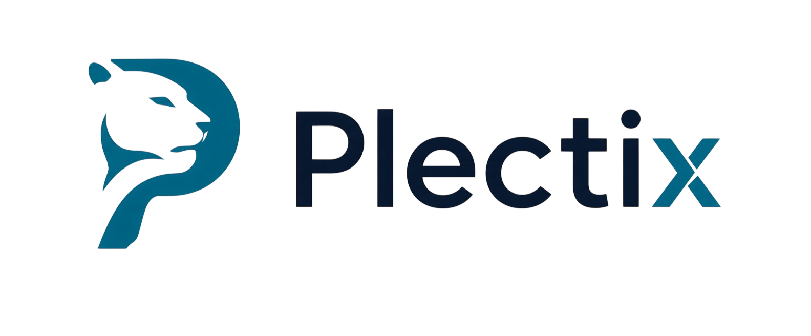

<div align="center">
  
  <br />
  <br />

  [](https://www.python.org/)
  [](https://fastapi.tiangolo.com/)
  [](https://react.dev/)
  [](https://www.postgresql.org/)
  [](https://tailwindcss.com/)
  [](https://www.docker.com/)
</div>

<br />

<div align="center">
  <strong>AI-first Learning Management System</strong>
  <br />
  Students get personalized learning paths. Authors build courses with AI copilot.
  <br />
  <br />
</div>

---

<details>
<summary><strong>Table of Contents</strong></summary>

- [What is this](#what-is-this)
- [Features](#-features)
- [Stack](#-stack)
- [Quick Start](#-quick-start)
- [Project Structure](#-project-structure)
- [Contributing](#-contributing)
- [License](#-license)

</details>

---

## What is this

A modern, AI-first **Learning Management System** built as a monorepo. Students enroll in courses, complete lessons with text/quiz/code blocks, and receive AI-powered personalized learning paths. Authors build content with a visual constructor and AI copilot.

## ✨ Features

| Feature | Description |
|---------|-------------|
| 🧠 **AI Course Generate** | Authors describe a topic — AI generates full course structure (modules, lessons, blocks) |
| 🎯 **TGP — The Golden Path** | Pre-course placement test. AI evaluates answers → recommends which modules to study fully vs. optionally |
| 🤖 **AI Assistant (Irbis)** | Inline hints, streaming Q&A, code diagnosis — right inside the learning flow |
| 📝 **Visual Content Builder** | Drag-and-drop course constructor with real-time preview |
| 💻 **Code Execution** | Auto-graded coding tasks via Piston sandbox (Python, JS, TS, Go) |
| 🏆 **Profile & Gamification** | Streaks, achievements, weekly/yearly contribution grids |
| 🛡 **Moderation** | AI pre-screening + manual review queue for course publishing |

## 📊 Stack

| Layer | Technologies |
|-------|-------------|
| 🐍 Backend | Python 3.14, FastAPI, SQLAlchemy 2.0 async, Alembic, Pydantic v2 |
| 🎨 Frontend | React 19, TypeScript, Vite, Tailwind CSS v4, shadcn/ui, TanStack Router + Query |
| 🗄 Database | PostgreSQL 18, Redis 7.2 |
| 🤖 AI | OpenAI-compatible gateway (Gemini/GPT), Celery workers |
| 💾 Storage | Local / S3 (MinIO) via aioboto3 |
| 🧪 Code Exec | Piston v2 sandbox |
| 🐳 Infra | Docker Compose |

## 🚀 Quick Start

```bash
# 1. Start infrastructure
docker compose up -d

# 2. Backend
cd backend
uv run alembic upgrade head
uv run uvicorn src.main:app --reload

# 3. Frontend
cd frontend
pnpm install
pnpm dev

# 4. AI worker (optional)
cd backend
uv run celery -A src.core.celery_app worker --loglevel=info
```

Open [http://localhost:5173](http://localhost:5173)

## 📁 Project Structure

```
├── backend/src/
│   ├── core/           # Shared infrastructure (config, DB, Redis, storage, errors)
│   ├── auth/           # Register / login / refresh / logout
│   ├── user/           # Profiles, staff flag
│   ├── course/         # Courses, enrollment, categories, moderation
│   ├── module/         # Course modules
│   ├── lesson/         # Lessons + per-user progress
│   ├── block/          # Content blocks (text, quiz, code, media)
│   ├── submissions/    # Auto-grading + manual checks
│   ├── codeexec/       # Piston HTTP client
│   ├── media/          # Uploads (local/S3), attachments
│   ├── profile/        # Stats, streaks, contribution grids
│   └── ai/             # TGP, Assistant, Course Review
├── frontend/src/
│   ├── client/         # GENERATED API client — DO NOT EDIT
│   ├── components/     # Shared UI (shadcn/ui) + layout
│   ├── features/       # Feature modules (api/, pages/, components/)
│   ├── styles/         # Tailwind v4 design system
│   └── routes/         # TanStack Router routes
├── docker-compose.yaml
└── scripts/
```

## 🤝 Contributing

Contributions are welcome! Please open an issue or submit a pull request.

1. Fork the repository
2. Create a feature branch
3. Make your changes
4. Run `pnpm lint` (frontend) or `uv run mypy .` (backend)
5. Submit a PR

## 📄 License

Proprietary. All rights reserved.

Copyright © 2026 caloz. No part of this software may be reproduced,
distributed, or transmitted in any form or by any means without the prior
written permission of the copyright holder.

**Educational use:** Distribution for non-commercial, educational purposes
(school projects, academic demonstrations) is permitted provided that
all copyright notices are retained.
